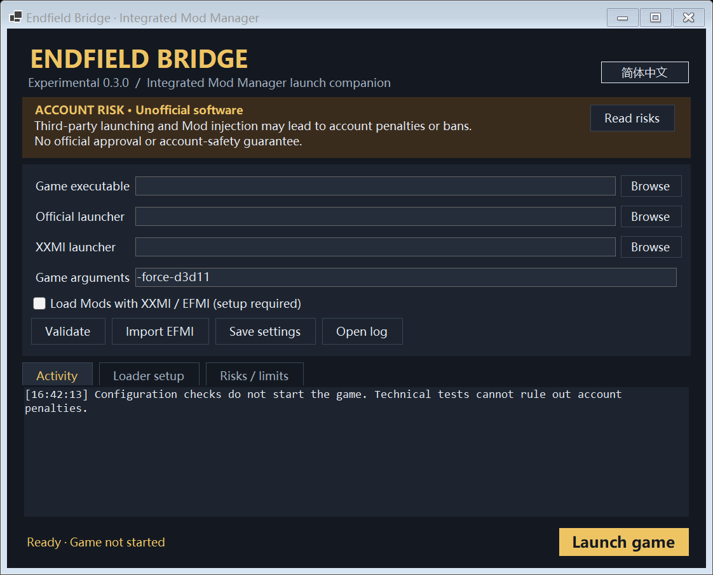

# Endfield Bridge

[简体中文](README.zh-CN.md) | English

> **ACCOUNT RISK: This is unofficial software. Third-party launching and DLL-based Mods may lead to account penalties, including bans. There is no ban-free guarantee. Read [RISK.md](RISK.md) before using it.**

**License: AGPL-3.0-only.** Copyright (c) 2026 EndfieldBridge contributors; upstream credits in [NOTICE.md](NOTICE.md). Provided without warranty.

A Windows desktop companion for starting Arknights: Endfield with an official signed parent process, with optional XXMI / EFMI integration and an entry point for Integrated Mod Manager.



## Features

- Chinese / English interface with a saved language preference.
- Separate launch settings, activity, loader setup, and risk information.
- Official `Games.exe` discovery, Authenticode trust checks and signer-organization checks.
- A suspended official parent process selected using the Windows process-creation API.
- Optional XXMI / EFMI Custom Launch integration; Mod loading stays with the installed loader.
- Configuration backup and field-level restore that preserves unrelated settings.
- Read-only verification of XXMI command authorization using its public key; no private-key access.
- `StartFromModManager.cmd` for managers that accept a launcher file but cannot pass arguments.

Signature checks, process creation, and injection logs are **not evidence of official approval or account safety**. The project is not affiliated with or endorsed by Hypergryph, GRYPHLINE, or the XXMI project.

## Requirements

- Windows 10/11 x64. Release packages include the .NET runtime; developer framework-dependent builds require .NET 9 Desktop Runtime.
- Your own installed game and official mainland-China Hypergryph launcher with a valid signed `Games.exe`.
- XXMI / EFMI installed separately if you choose Mod mode.
- Administrator consent when launching requires it. Opening the settings window does not require elevation.

Other regions, Wine/Proton, and different loader versions have not been validated by this project. No official game files or loader libraries are included.

## Install

Download the Windows x64 **Setup.exe** or **portable.zip** from [Releases](https://github.com/uyujkk/EndfieldBridge/releases). Both include .NET 9.0.21 in one EXE. The package root contains only the EXE, manager entry, quick guide, `docs` and `licenses`; settings and logs go into `data` on first run. The installer installs for the current user, preserves user-generated settings on same-folder upgrades and does not launch the game. Read [INSTALL.md](INSTALL.md) before upgrading, moving or uninstalling an existing bridge. Each release also provides the matching source archive and SHA-256 checksums.

## Build and run

```powershell
dotnet build src/EndfieldBridge.csproj -c Release -o app
.\app\EndfieldBridge.exe
```

The output is framework-dependent. Keep the generated DLL, runtime configuration, and executable together.

1. Select the actual `Endfield.exe` and, optionally, the actual `XXMI Launcher.exe`.
2. Leave **Official Games.exe** empty to discover the official launcher, or select it manually.
3. Use **Import EFMI** to read the configured game path and arguments, then **Validate**.
4. To enable Mods, exit the game and XXMI. Open **Loader setup**, select **Back up & set up**, and enable Mod mode.
5. On XXMI's first protected-settings prompt, verify the exact bridge executable and arguments, then choose **Keep**. **Reset** clears the command. XXMI creates the authorization signature itself.

The **game folder** in XXMI must be the folder containing `Endfield.exe` and `Endfield_Data`. Do not enter a shortcut, the bridge executable, or the loader executable there.

### Integrated Mod Manager

Select **Copy manager entry**, then choose the copied `StartFromModManager.cmd` as the launcher path for the Endfield repository in your manager. The bridge does not directly edit manager repositories or change other game profiles.

The intended chain is: manager → bridge → XXMI / EFMI → bridge Custom Launch → game. Without Mod mode, the bridge starts the game directly. Do not put a waiting bridge command in XXMI's pre-launch command field.

### Settings and restore

`data/profile.json`, `data/bridge.log`, and backup metadata are written in the application data subfolder. This folder must be writable. Logs and backups can contain local paths; review them before sharing.

Setup changes seven EFMI importer fields: `game_launch`, `start_method`, `game_folder`, `game_process_exe_enabled`, `game_process_exe`, `custom_launch`, and, only when the command changes, `custom_launch_signature`. Other importer settings and game profiles are preserved.

Use **Restore EFMI** before moving the application folder. Restore returns the saved launch fields, including any originally invalid values; choose a valid game folder afterward if necessary. Local restore cannot undo any game-operator records.

### Command line

| Option | Purpose |
| --- | --- |
| No arguments | Open the settings window |
| `--launch` | Launch using the saved mode; may request UAC |
| `--game-only` | Launch without invoking XXMI |
| `--game-only --from-xxmi` | Loader callback; read current EFMI arguments |
| `--self-test` | Run isolated fixtures and a harmless self-process parent probe |
| `--render-preview <png> --language=en-US --page=risk` | Render a UI preview without launching the game |

## Validation and limits

Self-tests cover argument quoting, configuration backup/restore, unrelated-field preservation, malformed game-folder handling, public-key command verification, language switching, and actual Windows parent-process IDs using this program as both probe processes. They never launch the game or perform Mod injection. The official-signature integration check is skipped when no local game profile is configured.

A local user-run session produced an XXMI DLL-injection success log. This is bounded evidence of that session, not a guarantee of visual Mod correctness, future compatibility, or account safety. A live game launch is intentionally not part of automated tests.

## References and implementation provenance

The following sources informed development. A reference acknowledges what was reviewed; it does not imply endorsement or permission from its authors.

| Source | How it was used |
| --- | --- |
| [BlockyDeer/endfield-nolauncher](https://github.com/BlockyDeer/endfield-nolauncher) | Its README and locally downloaded source were reviewed to understand the suspended official process and parent-process launch approach. |
| [Dr-hydra/Better-Endfield](https://github.com/Dr-hydra/Better-Endfield) | Upstream of endfield-nolauncher. The original launch source at commit 514f6d6 and its license were directly checked during the 2026-10-15 provenance review. |
| [SpectrumQT/XXMI-Launcher](https://github.com/SpectrumQT/XXMI-Launcher) | Its public source was reviewed for Custom Launch configuration, process detection, and command-signature verification to support interoperability. |
| Microsoft Windows API documentation: [parent-process attribute](https://learn.microsoft.com/en-us/windows/win32/api/processthreadsapi/nf-processthreadsapi-updateprocthreadattribute), [WinVerifyTrust](https://learn.microsoft.com/en-us/windows/win32/api/wintrust/nf-wintrust-winverifytrust) | API contracts used for process creation, parent selection, and official-file signature verification. |

The launch approach and argument-quoting structure were adapted after reviewing endfield-nolauncher, whose upstream is Better-Endfield. This is **not a clean-room implementation**. The standalone bridge is distributed under AGPL-3.0-only, with upstream provenance and dated modifications in [NOTICE.md](NOTICE.md).

## License

[GNU Affero General Public License version 3 only (AGPL-3.0-only)](LICENSE).
Copyright (c) 2026 EndfieldBridge contributors; upstream rights remain with their
respective authors and contributors. See [NOTICE.md](NOTICE.md) and [CHANGELOG.md](CHANGELOG.md)
for source provenance and the 2026-10-15 modifications. This program is distributed
WITHOUT ANY WARRANTY. You may copy, modify and redistribute it under the license.

Installers and portable binaries are accompanied on the same release page by an
explicit corresponding-source ZIP containing the tagged bridge source and build
and installer scripts. .NET runtime notices are included separately in binary
packages. XXMI, game files and Mods are obtained and licensed separately.

This licensing change applies to the standalone EndfieldBridge project, not to
the separate Integrated Mod Manager. Copyright permissions do not authorize use
against the game operator's rules; see [RISK.md](RISK.md).