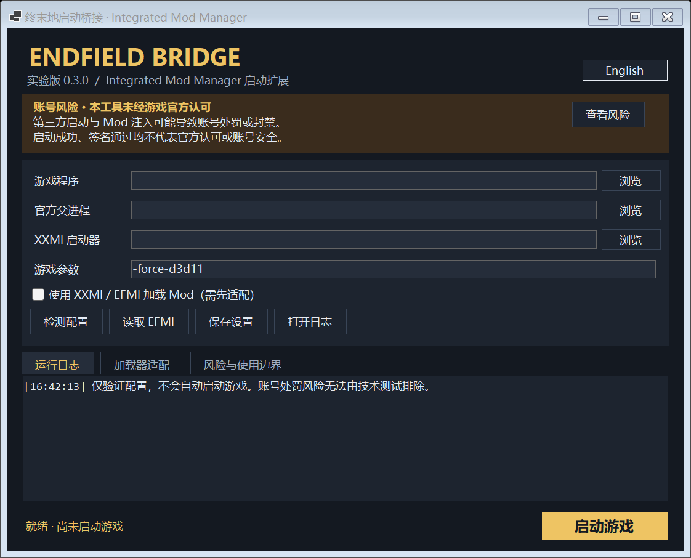

# Endfield Bridge · 终末地启动桥接

简体中文 | [English](README.md)

> **账号风险：本工具未经游戏官方认可。第三方启动方式与 DLL Mod 加载可能导致账号处罚或封禁，没有“不封号”保证。使用前请阅读[风险说明](RISK.zh-CN.md)。**

Windows 图形化启动工具，使用官方签名的父进程启动终末地，并提供可选 XXMI / EFMI 联动以及 Integrated Mod Manager 的文件启动入口。



## 功能

- 简体中文 / English 切换，保存语言偏好。
- 启动设置、运行日志、加载器适配、风险说明分区。
- 自动寻找官方 `Games.exe`，检查 Authenticode 签名和签名组织。
- 使用 Windows 父进程属性创建游戏，官方辅助进程保持挂起。
- 通过 XXMI 的 Custom Launch 接口衔接；Mod 加载交给已安装的 XXMI / EFMI。
- 修改前备份配置，恢复时只处理启动字段，保留其他仓库和设置。
- 只使用 XXMI 公钥验证授权，不读取私钥或替用户签名。
- 生成 `StartFromModManager.cmd`，适配只能选择文件、不能传参数的管理器。

**签名通过、游戏启动成功、DLL 注入成功，都不能证明官方许可或账号安全。** 本项目与鹰角、GRYPHLINE 和 XXMI 项目无隶属或认可关系。

## 环境与构建

Windows 10/11 x64，.NET 9 桌面运行时；构建需 .NET 9 SDK。游戏和国服官方启动器由用户自行安装，使用 Mod 时另需 XXMI / EFMI。

```powershell
dotnet build src/EndfieldBridge.csproj -c Release -o app
.\app\EndfieldBridge.exe
```

这是依赖 .NET 运行时的版本，需要保留输出目录中的 EXE、DLL 和运行时配置。打开配置界面不要求管理员权限，实际启动按需触发 UAC。

其他区服、Wine/Proton 以及不同加载器版本尚未由本项目验证。仓库不包含任何官方游戏文件或加载器 DLL。

## 使用

1. 选择实际的 `Endfield.exe` 和可选的 `XXMI Launcher.exe`；不要选择 `.lnk`。
2. “官方父进程”留空自动查找，或者手动选择官方 `Games.exe`。
3. 可先“读取 EFMI”，再“检测配置”。
4. 需要 Mod 时先退出游戏与 XXMI，在“加载器适配”中点击“备份并适配 EFMI”，并启用 Mod 模式。
5. 首次 XXMI 提示“验证不安全设置失败”时，核对命令确实指向本工具后选择“保持”。XXMI 会自行签名；“重置”会清空命令。

XXMI 的游戏目录必须是包含 `Endfield.exe` 和 `Endfield_Data` 的真实目录，不能填写快捷方式、桥接程序或 XXMI 程序。

### 接入 Mod 管理器

点击“复制管理器入口”，在管理器的终末地仓库中，将启动器路径选择为复制的 `StartFromModManager.cmd`。桥接不会直接修改管理器仓库。

调用关系：管理器 → 桥接 → XXMI / EFMI → 自定义命令调用桥接 → 游戏。未启用 Mod 时，桥接直接创建游戏进程。请勿将等待游戏退出的桥接命令填入 XXMI 的前置命令。

### 配置与恢复

程序在自身目录写入 `profile.json`、`bridge.log` 和备份元数据，因此该目录需要可写。日志和配置备份可能包含本机路径，分享前请检查。

适配修改 EFMI 的七个字段：`game_launch`、`start_method`、`game_folder`、`game_process_exe_enabled`、`game_process_exe`、`custom_launch`，以及仅在命令改变时更新的 `custom_launch_signature`。其他设置保留。

移动工具目录前，先在原位置恢复 EFMI，再在新位置适配。恢复会返回原始字段，包括原本无效的目录；必要时重新选择有效目录。本地恢复不能撤销运营方可能已有的记录。

## 测试与验证边界

运行 `app\EndfieldBridge.exe --self-test`。测试只使用隔离配置和本工具自身的探针进程，不启动游戏、不执行 Mod 注入。未配置本机游戏时跳过官方签名集成检查，其他测试可独立运行。

覆盖引号转义、适配与恢复、其他字段保留、错误目录保护、XXMI 公钥验签、语言切换及真实 Windows 父进程 ID。

已有一次用户运行的本机日志记录了 XXMI DLL 注入成功；这不能代替 Mod 画面验证，更不能证明账号安全或未来兼容。

## 参考与实现来源

以下资料为开发提供了参考。列出来源是为了如实说明阅读和参考范围，不代表相关作者认可本项目或另行授予了使用许可。

| 来源 | 参考范围 |
| --- | --- |
| [BlockyDeer/endfield-nolauncher](https://github.com/BlockyDeer/endfield-nolauncher) | 阅读了其 README 和下载到本地的源码，用于理解挂起官方进程、指定游戏父进程的启动方案。 |
| [Dr-hydra/Better-Endfield](https://github.com/Dr-hydra/Better-Endfield) | 间接上游参考：endfield-nolauncher 声明其启动实现来源于该项目。本项目开发过程中未直接审阅该上游代码。 |
| [SpectrumQT/XXMI-Launcher](https://github.com/SpectrumQT/XXMI-Launcher) | 查看了公开源码中的自定义启动配置、进程识别和命令签名验证方式，用于实现互操作。 |
| Microsoft Windows API 文档：[父进程属性](https://learn.microsoft.com/en-us/windows/win32/api/processthreadsapi/nf-processthreadsapi-updateprocthreadattribute)、[WinVerifyTrust](https://learn.microsoft.com/en-us/windows/win32/api/wintrust/nf-wintrust-winverifytrust) | 作为进程创建、父进程选择和官方文件签名验证的接口依据。 |

本仓库没有直接合入上述项目的源文件。但开发过程确实阅读过第三方源码，因此这里**不宣称属于 clean-room 实现，也不宣称许可证兼容性已通过独立审查**。使用另一种编程语言实现相同功能，本身不能证明实现与所阅读代码不存在衍生关系。

## 许可证

本项目源码声明使用 [MIT](LICENSE)，这不会改变参考项目或第三方组件的原有许可。特别是 endfield-nolauncher 声明使用 AGPL-3.0；如果实际复制、翻译、改编或以其他方式合入其受版权保护的代码，构成受该许可覆盖的衍生作品，仅标注来源并不足以履行义务，需要遵守适用许可证，或取得相关权利人的额外授权。

源码版权许可与游戏运营规则是两回事：MIT 和上述致谢均不构成游戏官方对第三方工具使用方式的许可。请同时阅读[风险说明](RISK.zh-CN.md)。

[完整英文说明和命令参数](README.md)
